# 校园出入管理系统需求分析、设计与实现

校园出入管理系统面向学校门禁与访客管理场景，供校园内各类用户通过浏览器访问使用，
当前已部署于 GitHub Pages（https://carl-tu.github.io/campus-management/ ，初始账号 admin / 123456）。
系统用户涵盖管理员、校园管理者、教师、学生与访客五种角色，不同角色可使用的功能范围不同。

## 3.2.1 校园出入管理功能需求分析

校园出入管理功能应满足校园门禁与访客管理的业务需求，其核心流程包括用户登录、访客登记、
出入申请与审批、出入记录查询、异常预警、统计报表、用户与角色权限管理七个环节。

### 1. 用户登录模块需求分析

用户登录模块是使用系统的首要入口，应满足各类用户的接入需求与系统安全性要求。
用户通过浏览器访问系统，输入账号与密码进行身份认证，系统应对必填项进行校验并在
认证失败时给出友好提示，同时支持回车快捷登录，操作应方便易用。未登录用户访问受
保护功能时应自动跳转至登录页，已登录用户访问登录页时应自动跳转至首页，确保系统
的访问安全。登录成功后系统应根据用户角色展示相应的功能范围，实现按角色的权限管控，
并保持登录状态直至用户主动退出。用户登录功能对应的用例图如图 3-1 所示。


**图 3-1 用户登录模块用例图**

### 2. 访客登记模块需求分析

访客登记模块是校园出入管理的基础环节，应满足来访人员信息登记与查询的需求。
登记信息应包括访客姓名、手机号（需进行格式校验）、访客类型（访客/教师/学生/校园管理者）、
身份证号、来访事由、校内对接人及预计到访时间等关键内容，其中手机号等关键字段为必填项。
登记提交后系统应实时在当日访客列表中展示登记结果，并以彩色标签区分访客类型，方便
门卫与管理人员核对。对于登记有误的记录，应支持删除操作，删除时需二次确认以防止误操作。
访客登记功能对应的用例图如图 3-2 所示。


**图 3-2 访客登记模块用例图**

### 3. 出入申请与审批模块需求分析

出入申请与审批模块是校园出入管理的核心业务环节，应同时满足申请人与审批人双方的需求。
申请人可填写申请人、人员类型、手机号、事由、目标区域、预计时间等信息发起出入申请，
提交后申请进入待审批状态。审批人对待审批申请可执行通过或拒绝操作，系统应自动记录
审核人与审核时间，并将申请状态流转为已通过或已拒绝。该模块还应支持按申请人姓名与
申请状态的条件筛选查询，并提供申请详情查看与分页浏览功能，方便对大量申请的高效管理。
出入申请与审批功能对应的用例图如图 3-3 所示。

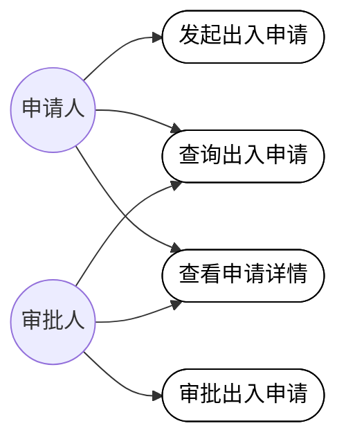

**图 3-3 出入申请与审批模块用例图**

### 4. 出入记录查询模块需求分析

出入记录查询模块是校园安全追溯的重要支撑，应满足管理人员对通行数据的检索与分析需求。
系统应支持按姓名、出入方向（进入/离开）、闸口（东门/西门/南门/北门）及日期范围进行
组合查询，列表应展示人员类型、方向、闸口、通行时间及验证方式（人脸识别/刷卡/二维码）
等关键信息，并以不同标签区分进入与离开方向。该模块还需支持查询结果的导出与分页浏览，
满足数据留档与上报的要求。出入记录查询功能对应的用例图如图 3-4 所示。

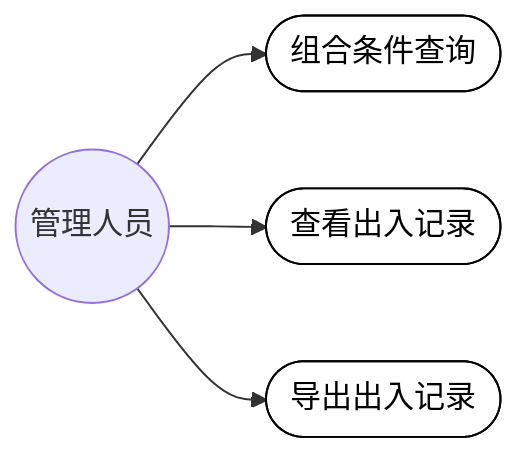

**图 3-4 出入记录查询模块用例图**

### 5. 异常预警模块需求分析

异常预警模块是校园安全防控的关键功能，应满足管理人员及时发现与处置异常情况的需求。
系统应对未授权进入、超时未离校、频繁出入、黑名单命中等异常情况生成预警记录，并以
统计卡片形式实时展示未处理预警、超时未离校、未授权进入及全部预警的数量。管理人员
可对预警进行单条标记已读、一键全部已读及处理操作，处理后的预警状态置为已处理，
形成"发现—处置—闭环"的安全管理流程。异常预警功能对应的用例图如图 3-5 所示。

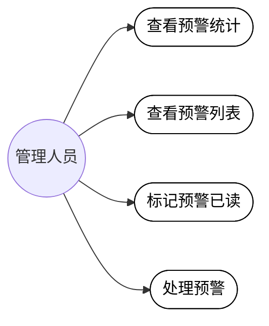

**图 3-5 异常预警模块用例图**

### 6. 统计报表模块需求分析

统计报表模块是辅助管理决策的重要工具，应满足管理者对通行数据可视化分析的需求。
系统应提供今日进入、今日离开、今日访客、待处理预警等关键指标卡片，以柱状图展示
近七日出入趋势，以占比形式展示学生、教师、访客、校园管理者等人员类型分布，并统计
各闸口的进入与离开人数、高峰时段及通行率，最后支持报表数据的导出，为校园安保
资源调配提供数据依据。统计报表功能对应的用例图如图 3-6 所示。


**图 3-6 统计报表模块用例图**

### 7. 用户与角色权限管理模块需求分析

用户与角色权限管理模块是系统安全运行的基础保障，应满足管理员对系统用户与权限统一
管控的需求。用户管理方面，管理员可按用户名、角色、状态检索用户，完成用户的新增、
编辑、禁用/启用与删除等维护操作，被管理对象覆盖全部五种角色。角色权限管理方面，
系统预置管理员、校园管理者、教师、学生、访客五种角色，管理员可新增或编辑角色，
并在用户管理、角色管理、出入申请审批、访客登记、记录查询、异常预警、统计报表等
权限点中为角色分配权限；内置的管理员角色受保护不可删除，防止权限失控。
用户与角色权限管理功能对应的用例图如图 3-7 所示。

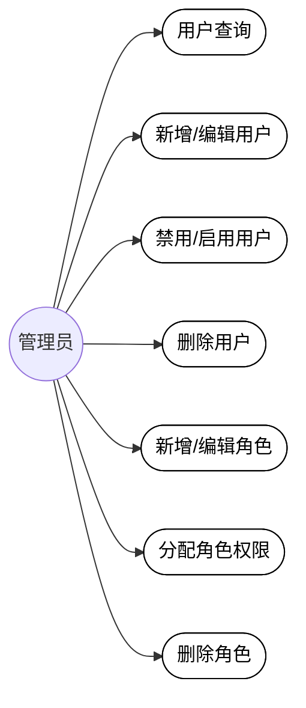

**图 3-7 用户与角色权限管理模块用例图**

不同角色可使用的功能范围不同：管理员拥有全部功能；校园管理者可进行访客登记、
出入申请与审批、出入记录查询、异常预警及统计报表；教师可进行访客登记、出入申请
与审批、出入记录查询；学生可进行访客登记、出入申请及出入记录查询；访客仅可进行
访客登记与出入申请。校园出入管理功能的总用例图如图 3-8 所示。

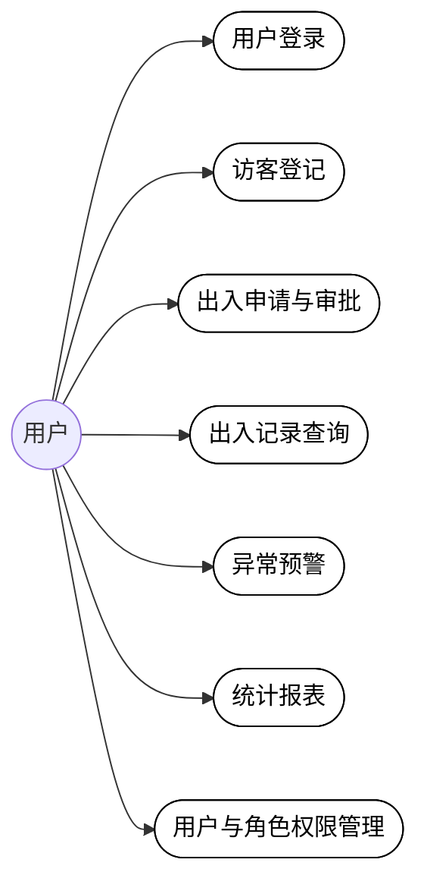

**图 3-8 校园出入管理功能总用例图**

## 3.3 非功能需求分析

本系统非功能需求分析主要包括以下内容：

### 3.3.1 性能需求分析

系统各功能页面的加载时间要快，一般需控制在 2 秒以内；出入申请提交、审批操作及
访客登记后，系统的反馈时间需小于 1 秒；上下课等高峰时段需支持多用户同时访问，
并发用户数可设置为大于 500；出入记录、申请列表等数据应采用分页加载，避免一次性
加载大量数据造成页面卡顿，保障系统的响应速度与流畅体验。

### 3.3.2 可靠性需求分析

系统可靠性、可用性需达到 99.9% 及以上，系统故障恢复的时间要小于等于 20 分钟，
特别要避免由于宕机导致登记信息、申请数据丢失或服务中断的情况。前端应做好异常
捕获与友好提示，保证在网络异常或操作失败时不产生脏数据；对删除用户、删除登记
记录等危险操作提供二次确认机制，防止数据被误删，确保系统持续稳定运行。

### 3.3.3 安全性需求分析

系统需要通过多种措施来确保系统的安全性，可以从系统的机密性、权限身份认证、
数据完整性等措施来实现。机密性方面，可以确保用户密码等敏感信息在传输与存储过程
中不被泄露，如通过 HTTPS 加密传输、敏感字段脱敏展示。权限身份认证方面，用户需
登录后方可使用系统，通过路由守卫对未登录访问进行拦截，并按管理员、校园管理者、
教师、学生、访客五种角色限制功能使用范围，在访问控制与身份认证等环节确保系统安全。
数据完整性方面，对手机号等关键字段进行格式校验，防止非法数据录入，并对审批、
预警处置等关键操作记录审核人与操作时间，做到行为可追溯。

### 3.3.4 可扩展性需求分析

系统应采用模块化设计，访客登记、出入申请与审批、出入记录查询、异常预警、统计
报表、用户与角色权限管理等各功能模块之间低耦合，便于后续扩展黑名单管理、人脸识别
对接、多校区支持等新业务功能；权限点支持灵活配置，新增角色或权限项时无需调整系统
整体架构；页面组件、类型定义与状态管理模块可复用，便于快速扩展新的页面与功能，
保护已有投资。

### 3.3.5 可维护性需求分析

前端应采用目前常用的核心技术（Vue 3 + TypeScript + Vite + Element Plus），构成
系统网页结构、样式和交互；代码采用组件化组织与 Pinia 状态管理，路由与权限配置
集中管理，降低代码阅读与修改难度；支持独立更新出入申请管理、记录查询、统计报表等
功能模块，配合持续集成自动构建部署，最大程度降低维护成本。

### 3.3.6 兼容性需求分析

系统应需多端适配，能支持主流浏览器（如 Chrome、Edge、Safari、Firefox 及各类国产
浏览器），系统界面应能自动适配手机、平板、电脑等电子设备的分辨率；采用响应式布局，
侧边栏与内容区在不同屏幕尺寸下均能正常展示，确保用户在不同终端上获得一致的使用体验。

### 3.3.7 易用性需求分析

系统界面应简洁直观，操作逻辑符合用户使用习惯，降低学习成本；采用左侧菜单导航与
多标签页设计，方便用户在各功能模块间快速切换与返回；表单提供清晰的必填标识、格式
校验与操作反馈提示（如登录成功/失败、登记成功、审批完成提示），删除等危险操作提供
二次确认；人员类型、预警状态、通行方向等关键信息以彩色标签、统计卡片等可视化形式
呈现，便于用户快速理解与使用。

## 4.1 总体设计

### 4.1.1 总体架构设计

系统采用前后端分离的 B/S（浏览器/服务器）架构，用户通过浏览器访问系统，无需安装
专用客户端。系统自上而下分为表现层、业务逻辑层与数据层三个层次：

（1）表现层：基于 Vue 3 组件与 Element Plus 组件库构建，包含登录页、系统布局框架
（侧边栏菜单、顶部栏、多标签页）以及访客登记、出入申请与审批、出入记录查询、异常
预警、统计报表、用户管理、角色权限管理等业务页面，负责页面渲染与用户交互。

（2）业务逻辑层：基于 Vue Router 实现页面路由跳转与登录访问控制（路由守卫），基于
Pinia 实现认证状态（auth）与多标签页状态（tabs）管理，并以 TypeScript 统一约束
用户、访客登记、出入申请、出入记录、预警、角色等业务数据结构，承载系统核心业务规则。

（3）数据层：当前阶段采用浏览器 localStorage 存储模拟数据，项目已引入 Axios 客户端，
预留与后端 RESTful 接口的对接能力，后续可平滑接入数据库实现数据持久化。

系统总体架构图如图 4-1 所示。

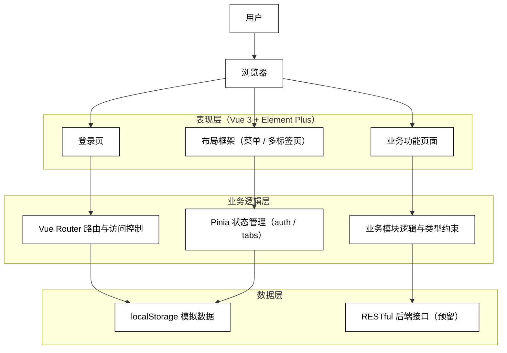

**图 4-1 系统总体架构图**

### 4.1.2 总体功能设计

系统围绕校园出入管理业务，按职责划分为用户认证、访客登记、出入申请与审批、出入
记录查询、异常预警、统计报表、系统管理七大功能模块。用户认证模块是使用系统的入口，
提供登录、登出与访问控制；访客登记模块完成来访人员信息的登记、查看与维护；出入
申请与审批模块实现申请的发起、审核与查询；出入记录模块支撑通行数据的组合检索与
导出；异常预警模块实现异常情况的统计、展示与处置；统计报表模块提供通行数据的
可视化分析；系统管理模块负责用户与角色权限的统一维护。系统总体功能框图如图 4-2 所示。

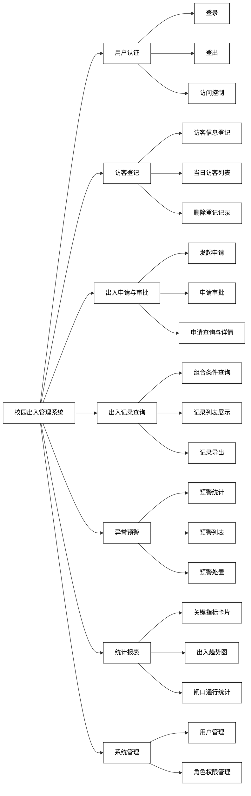

**图 4-2 系统总体功能框图**

## 4.2 功能设计

系统功能模块与 3.2.1 节的功能需求一一对应，下面对各功能模块的设计逐一介绍。

### 4.2.1 用户登录模块设计

登录模块由登录表单与认证逻辑两部分组成。表单包含用户名、密码两个字段，均设必填
校验，密码支持明文/密文切换，并支持回车快捷登录。认证逻辑位于 Pinia 的 auth 状态
管理模块：校验通过后生成会话令牌，将令牌与用户信息持久化至 localStorage 并跳转
首页；校验失败则弹出错误提示。前端路由守卫统一拦截未认证访问并重定向至登录页，
已登录用户访问登录页时自动跳转首页。退出登录时清除会话信息与已打开的标签页，
回到登录页。用户登录功能流程图如图 4-3 所示。

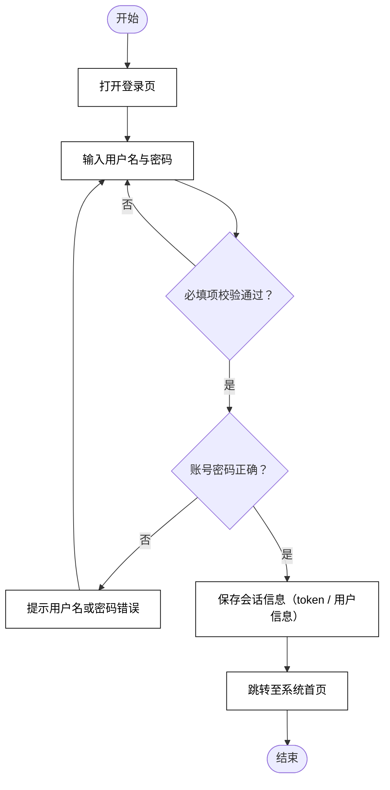

**图 4-3 用户登录功能流程图**

### 4.2.2 访客登记模块设计

访客登记模块由登记表单与当日访客列表两部分组成。表单字段包括姓名、手机号、访客
类型、身份证号、来访事由、校内对接人、预计到访时间，其中姓名、手机号、访客类型
为必填项，手机号按手机号码格式进行正则校验。提交成功后新记录置顶显示在当日访客
列表中并自动重置表单；列表以表格形式展示登记信息，人员类型以彩色标签区分，支持
行内删除操作，删除前通过确认弹窗进行二次确认。访客登记功能流程图如图 4-4 所示。

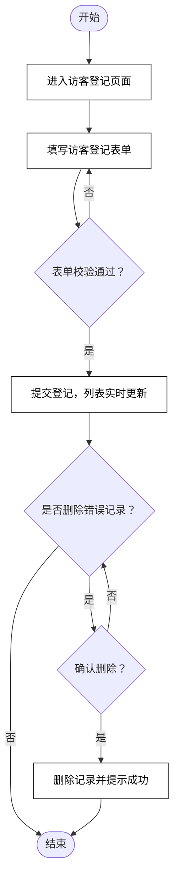

**图 4-4 访客登记功能流程图**

### 4.2.3 出入申请与审批模块设计

模块由搜索筛选区、申请列表与申请对话框组成。搜索区支持按申请人姓名与状态筛选，
可一键重置。发起申请对话框采集申请人、人员类型、手机号、事由、目标区域、预计
时间等信息，提交后状态置为待审批。列表以状态标签区分待审批、已通过、已拒绝三种
状态，对待审批记录提供通过与拒绝操作，操作时自动写入审核人与审核时间；所有记录
支持查看详情对话框，并提供页大小切换与跳页的分页控件。出入申请与审批功能
流程图如图 4-5 所示。

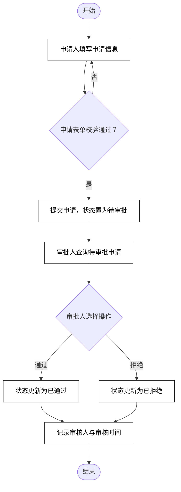

**图 4-5 出入申请与审批功能流程图**

### 4.2.4 出入记录查询模块设计

模块提供多条件组合查询表单与查询结果列表。查询条件包括姓名、出入方向、闸口
（东/西/南/北门）及日期范围；列表展示人员类型、方向、闸口、通行时间与验证方式，
其中进入与离开方向以不同颜色标签区分，验证方式将人脸识别、刷卡、二维码等编码
映射为文字展示。查询条件变更后自动重置页码，列表支持页大小切换、跳页及查询
结果导出。出入记录查询功能流程图如图 4-6 所示。

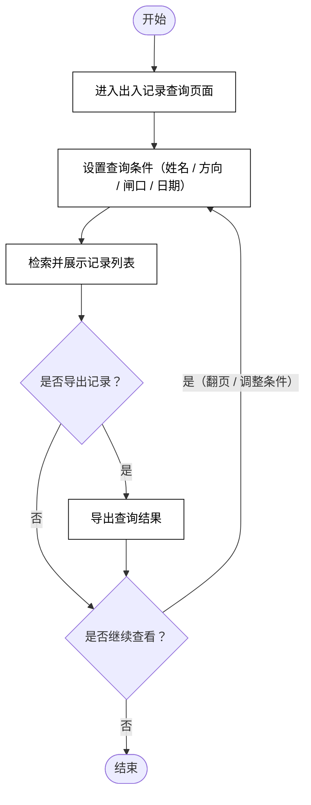

**图 4-6 出入记录查询功能流程图**

### 4.2.5 异常预警模块设计

模块顶部为四张统计卡片，分别展示未处理预警、超时未离校、未授权进入与全部预警
数量，由列表数据实时计算得出。预警列表覆盖未授权进入、超时未离校、频繁出入、
黑名单命中四类预警，状态分为未读、已读、已处理并以标签颜色区分。列表行内提供
标记已读与处理操作，工具栏提供一键全部已读；未读记录才显示标记已读按钮，非
已处理记录才显示处理按钮，形成"发现—处置—闭环"的处理流程。异常预警功能
流程图如图 4-7 所示。

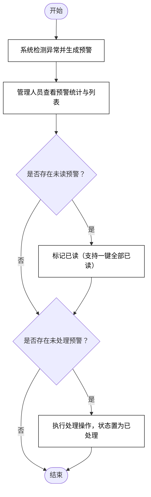

**图 4-7 异常预警功能流程图**

### 4.2.6 统计报表模块设计

模块由统计卡片、出入趋势图、人员类型分布与闸口通行统计四部分组成。统计卡片
展示今日进入、今日离开、今日访客、待处理预警四项关键指标；近七日出入趋势以
柱状图形式呈现；人员类型分布以占比列表形式展示学生、教师、访客、校园管理者的
数量与百分比；闸口通行统计表格包含各闸口进入人数、离开人数、高峰时段、高峰
人次及以进度条呈现的通行率，并预留报表导出入口。统计报表功能流程图如图 4-8 所示。

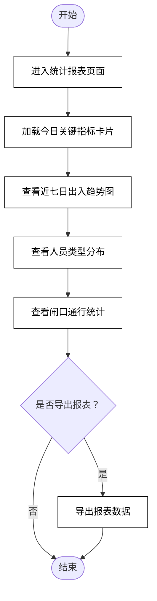

**图 4-8 统计报表功能流程图**

### 4.2.7 用户与角色权限管理模块设计

用户管理部分由搜索区（用户名/角色/状态）、用户列表与新增/编辑对话框组成，支持
用户信息的新增、编辑、禁用/启用切换与删除（二次确认），角色以彩色标签展示。角色
权限管理部分由角色列表与分配权限对话框组成：列表展示角色标识、名称与已分配权限
标签，支持新增、编辑角色与删除（内置管理员角色受保护不可删除）；分配权限对话框
以复选框形式在用户管理、角色管理、出入申请审批、访客登记、记录查询、异常预警、
统计报表七项权限点中进行勾选，默认权限矩阵见 3.2.1 节。用户与角色权限管理功能
流程图如图 4-9 所示。

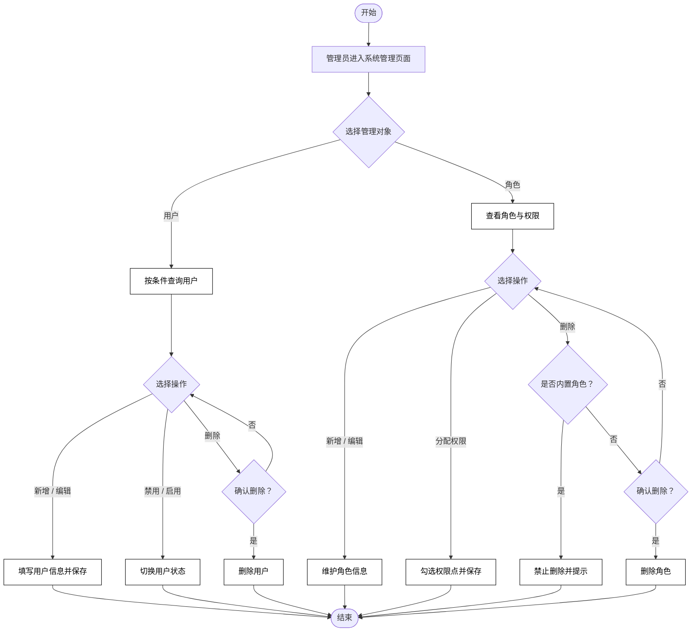

**图 4-9 用户与角色权限管理功能流程图**

## 4.3 非功能设计

### 4.3.1 性能设计

各功能页面通过 Vue Router 路由懒加载按需引入，避免首屏一次性加载全部页面代码；
Element Plus 组件按需引入以减小打包体积；出入记录、出入申请等大数据量列表采用
分页加载与条件筛选，减少一次性渲染的 DOM 节点数量；Pinia 集中管理认证与标签页
状态，避免重复计算；构建产物经 Vite 压缩混淆与资源拆分，并通过静态托管 CDN 分发，
保障页面加载时间控制在 2 秒以内、业务操作反馈时间小于 1 秒，满足高峰时段大于
500 并发用户的访问要求。

### 4.3.2 可靠性设计

前端对异常操作进行统一兜底处理，通过友好提示避免因异常导致页面崩溃或数据错乱；
对删除用户、删除登记记录、关闭全部标签等危险操作统一采用二次确认机制，防止误
操作造成数据丢失；登录令牌与用户信息持久化至浏览器本地存储，页面刷新后自动恢复
会话，避免重复登录；业务数据结构以 TypeScript 类型严格约束，在编译阶段即可发现
数据结构不一致问题；后续接入后端时将增加接口超时、失败重试与降级处理机制，
保障系统可用性达到 99.9% 以上、故障恢复时间小于 20 分钟。

### 4.3.3 安全性设计

系统安全性从身份认证、访问控制与数据安全三方面进行设计。身份认证方面，用户通过
账号密码登录获取会话令牌，登录态统一由认证状态模块管理。访问控制方面，Vue Router
全局路由守卫对未登录访问进行拦截并重定向至登录页；登录后按管理员、校园管理者、
教师、学生、访客五种角色控制功能使用范围，用户管理与角色权限管理功能仅管理员可
用。数据安全方面，密码输入框支持密文显示，敏感字段展示时可进行脱敏处理，系统
预留 HTTPS 传输加密与后端加密存储的对接能力；审批、预警处置、删除等关键操作
自动记录操作人与操作时间，做到行为可追溯。

### 4.3.4 可扩展性设计

系统采用模块化与组件化设计：各功能页面相互独立，新增功能模块只需增加视图组件
与路由配置，无需修改既有模块代码；权限点以数组字典形式集中定义，新增权限项或
角色只需扩展权限配置；业务数据结构统一在类型定义模块中声明，新增业务实体时
类型与页面代码同步扩展；状态管理按业务域拆分为认证（auth）、多标签页（tabs）
等多个 store，便于按域扩展；接口层预留 Axios 封装，后续可平滑扩展黑名单管理、
人脸识别对接、多校区支持等新功能。

### 4.3.5 可维护性设计

前端采用 Vue 3、TypeScript、Vite、Element Plus 等主流技术栈，生态成熟、资料丰富，
降低人员学习与交接成本；代码按视图、组件、状态、路由、类型分层组织，结构清晰；
Element Plus 统一界面风格，公共样式集中管理，界面调整成本低；配合 npm 脚本与
GitHub Actions 实现推送代码后自动构建与部署，减少人工干预；各功能模块相互独立，
支持对出入申请、统计报表等模块的单独更新与维护，最大程度降低维护成本。

### 4.3.6 兼容性设计

系统采用响应式布局，基于 Element Plus 栅格与弹性布局适配电脑、平板、手机等不同
分辨率设备，侧边栏支持折叠以适应小屏幕；前端构建目标兼容 Chrome、Edge、Safari、
Firefox 及各类国产主流浏览器；系统采用标准 Web 技术栈，无需安装专用客户端，
用户通过浏览器即可访问，确保在不同终端上获得一致的使用体验。

### 4.3.7 易用性设计

界面采用"侧边栏菜单 + 顶部栏 + 多标签页"的经典管理后台布局，符合用户使用习惯，
降低学习成本；菜单以图标加文字形式展示功能入口，层次清晰；表单统一提供必填标识、
格式校验与即时错误提示，登录、登记、审批等操作均有成功/失败消息反馈；删除等
危险操作提供二次确认；人员类型、预警状态、通行方向等关键信息以彩色标签、统计
卡片等可视化形式呈现，便于用户快速理解；多标签页支持关闭其他、关闭所有等快捷
操作，提升多任务处理效率。

## 5 系统实现

### 5.1 用户登录模块实现

用户登录模块在前端由登录页面（Login.vue）、认证状态模块（stores/auth.ts）与全局
路由守卫（router/index.ts）三部分协同实现。登录页面使用 Element Plus 的 el-form
组件承载表单，通过 rules 属性配置用户名、密码的必填校验规则，点击登录或回车时调用
validate 方法触发校验；校验通过后调用 Pinia 认证 store 的 login 方法进行身份核验，
核验通过则生成模拟会话令牌，将令牌与用户信息写入浏览器 localStorage 实现会话
持久化，并跳转至系统首页；核验失败则通过 ElMessage 弹出错误提示。访问控制方面，
在 Vue Router 的全局前置守卫 beforeEach 中统一判断目标路由是否需要认证：无令牌
的受保护访问一律重定向至登录页，已登录用户访问登录页则重定向至首页，从而实现
"未登录不可用、已登录不回头"的访问控制原理。退出登录时清除 localStorage 中的
令牌与用户信息并跳回登录页。关键代码如下：

```ts
// ===== src/stores/auth.ts：认证状态与登录核验 =====
export const useAuthStore = defineStore('auth', () => {
  const token = ref<string>(localStorage.getItem('token') || '')
  const userInfo = ref<UserInfo | null>(null)

  /* 登录：校验账号密码，成功后写入会话并持久化 */
  const login = (username: string, password: string): boolean => {
    if (username === 'admin' && password === '123456') {
      token.value = 'mock-token-' + Date.now()
      localStorage.setItem('token', token.value)
      userInfo.value = {
        id: 1,
        username: 'admin',
        realName: '系统管理员',
        phone: '13800138000',
        role: 'admin',
        department: '信息中心',
        status: 'active',
        createTime: '2024-01-01',
      }
      localStorage.setItem('userInfo', JSON.stringify(userInfo.value))
      return true
    }
    return false
  }

  /* 登出：清除会话信息 */
  const logout = () => {
    token.value = ''
    userInfo.value = null
    localStorage.removeItem('token')
    localStorage.removeItem('userInfo')
  }

  /* 恢复用户信息（页面刷新后自动恢复会话） */
  const restoreUser = () => {
    const saved = localStorage.getItem('userInfo')
    if (saved) {
      userInfo.value = JSON.parse(saved)
    }
  }

  return { token, userInfo, login, logout, restoreUser }
})
```

```ts
// ===== src/router/index.ts：全局路由守卫实现访问控制 =====
router.beforeEach((to, _from, next) => {
  const token = localStorage.getItem('token')
  if (to.meta.requiresAuth !== false && !token) {
    next('/login')            // 未登录访问受保护页面：重定向登录页
  } else if (to.path === '/login' && token) {
    next('/')                 // 已登录访问登录页：重定向首页
  } else {
    next()                    // 放行
  }
})
```

```ts
// ===== src/views/Login.vue：表单校验与登录提交 =====
const loginForm = reactive({ username: '', password: '' })

const rules: FormRules = {
  username: [{ required: true, message: '请输入用户名', trigger: 'blur' }],
  password: [{ required: true, message: '请输入密码', trigger: 'blur' }],
}

const handleLogin = async () => {
  if (!formRef.value) return
  await formRef.value.validate((valid) => {
    if (valid) {
      loading.value = true
      setTimeout(() => {
        const success = authStore.login(loginForm.username, loginForm.password)
        if (success) {
          ElMessage.success('登录成功')
          router.push('/')            // 登录成功跳转首页
        } else {
          ElMessage.error('用户名或密码错误')
        }
        loading.value = false
      }, 500)
    }
  })
}
```

### 5.2 访客登记模块实现

访客登记模块在页面内采用"上表单、下列表"的布局：表单通过 el-form 的 model 属性
绑定响应式表单对象 visitorForm，rules 属性配置姓名、手机号、访客类型的必填校验，
其中手机号通过自定义 validator 进行正则校验（/^1[3-9]\d{9}$/），不满足格式则回调
错误信息阻止提交。点击登记按钮触发 handleSubmit：先调用 validate 执行整体校验，
校验通过后以当前时间戳生成记录 ID、以系统时间生成登记时间，构造完整记录对象后
unshift 至今日访客列表头部实现"新记录置顶"的实时反馈，随后提示成功并重置表单。
重置时除调用 resetFields 清空校验字段外，还需手动清空身份证号等未参与校验的选填
字段。删除操作通过 ElMessageBox.confirm 弹出二次确认框，确认后按 ID 过滤数组
完成删除，防止误操作。关键代码如下：

```ts
// ===== src/views/VisitorRegistration.vue =====
/* 手机号自定义校验器 */
const phoneValidator = (
  _rule: unknown,
  value: string,
  callback: (error?: Error) => void,
) => {
  if (!value) { callback(new Error('请输入手机号')); return }
  if (!/^1[3-9]\d{9}$/.test(value)) { callback(new Error('手机号格式不正确')); return }
  callback()
}

/* 表单校验规则 */
const formRules: FormRules = {
  name: [{ required: true, message: '请输入姓名', trigger: 'blur' }],
  phone: [{ required: true, validator: phoneValidator, trigger: 'blur' }],
  visitorType: [{ required: true, message: '请选择访客类型', trigger: 'change' }],
}

/* 登记提交：校验通过后构造记录并置顶插入列表 */
const handleSubmit = async () => {
  if (!formRef.value) return
  await formRef.value.validate((valid) => {
    if (valid) {
      const record: VisitorRecord = {
        ...visitorForm,
        id: Date.now(),                       // 时间戳作为唯一 ID
        registerTime: new Date().toLocaleString(),
      }
      todayVisitors.value.unshift(record)     // 新记录置顶展示
      ElMessage.success('访客登记成功')
      resetForm()
    }
  })
}

/* 重置表单：校验字段 + 手动清空选填字段 */
const resetForm = () => {
  formRef.value?.resetFields()
  visitorForm.idCard = ''
  visitorForm.reason = ''
  visitorForm.targetPerson = ''
  visitorForm.expectTime = ''
}

/* 删除登记记录：二次确认后按 ID 过滤 */
const handleDelete = (row: VisitorRecord) => {
  ElMessageBox.confirm(`确定删除 "${row.name}" 的登记记录吗？`, '提示', { type: 'warning' })
    .then(() => {
      todayVisitors.value = todayVisitors.value.filter((v) => v.id !== row.id)
      ElMessage.success('删除成功')
    })
    .catch(() => {})
}
```

### 5.3 出入申请与审批模块实现

出入申请与审批模块通过对话框表单与列表行内操作配合实现。发起申请时，点击列表
头部按钮打开 el-dialog 对话框并清空表单，对话框内表单配置申请人、人员类型、
手机号、事由、目标区域、预计时间六项必填规则；提交时调用 validate 校验，通过后
构造 status 为 pending（待审批）的新申请对象，unshift 插入列表头部并同步分页
总数，最后关闭对话框并提示"申请已提交"。审批操作绑定在列表行内的通过/拒绝按钮上，
模板中通过 v-if="row.status === 'pending'" 控制按钮仅对待审批记录展示，实现状态
驱动的按钮可见性；审批时直接修改行对象的 status 字段，并自动写入审核人与审核
时间，利用 Vue 的响应式追踪机制使状态标签实时刷新，完成"待审批→已通过/已拒绝"
的状态流转。关键代码如下：

```ts
// ===== src/views/AccessApplication.vue =====
/* 发起申请表单校验规则 */
const applyRules: FormRules = {
  applicantName: [{ required: true, message: '请输入申请人', trigger: 'blur' }],
  applicantType: [{ required: true, message: '请选择人员类型', trigger: 'change' }],
  phone: [{ required: true, message: '请输入手机号', trigger: 'blur' }],
  reason: [{ required: true, message: '请输入事由', trigger: 'blur' }],
  targetArea: [{ required: true, message: '请输入目标区域', trigger: 'blur' }],
  expectedTime: [{ required: true, message: '请选择时间', trigger: 'change' }],
}

/* 提交申请：状态置为待审批并插入列表 */
const submitApplication = async () => {
  if (!applyFormRef.value) return
  await applyFormRef.value.validate((valid) => {
    if (valid) {
      const newApp: AccessApplication = {
        id: Date.now(),
        applicantName: applyForm.applicantName,
        applicantType: applyForm.applicantType as VisitorType,
        phone: applyForm.phone,
        reason: applyForm.reason,
        targetArea: applyForm.targetArea,
        applyTime: new Date().toLocaleString(),
        expectedTime: applyForm.expectedTime as string,
        status: 'pending',                    // 初始状态：待审批
      }
      applicationList.value.unshift(newApp)
      pagination.total++
      applyDialogVisible.value = false
      ElMessage.success('申请已提交')
    }
  })
}

/* 审批通过：流转状态并记录审核信息 */
const handleApprove = (row: AccessApplication) => {
  row.status = 'approved'
  row.reviewer = '管理员'
  row.reviewTime = new Date().toLocaleString()
  ElMessage.success('已通过')
}

/* 审批拒绝 */
const handleReject = (row: AccessApplication) => {
  row.status = 'rejected'
  row.reviewer = '管理员'
  row.reviewTime = new Date().toLocaleString()
  ElMessage.info('已拒绝')
}
```

```html
<!-- 列表行内操作：状态驱动按钮可见性 -->
<template v-if="row.status === 'pending'">
  <el-button type="success" link size="small" @click="handleApprove(row)">通过</el-button>
  <el-button type="danger" link size="small" @click="handleReject(row)">拒绝</el-button>
</template>
<el-button type="primary" link size="small" @click="handleDetail(row)">详情</el-button>
```

### 5.4 出入记录查询模块实现

出入记录查询模块以搜索表单与响应式分页对象协同实现。搜索表单 searchForm 绑定
姓名、方向、闸口与日期范围四个查询条件，各条件输入控件均设置 clearable 支持一键
清空；点击搜索时重置 pagination.page 为 1，使分页回到首页。列表通过 el-table
展示记录，其中方向字段以 el-tag 的 type 区分进入（success 绿色）与离开（warning
橙色），验证方式字段通过 verifyMap 字典将 face、card、qr 编码映射为"人脸识别/
刷卡/二维码"文案后展示。分页采用 el-pagination 组件，通过 v-model 双向绑定
current-page 与 page-size，layout 属性配置总数、页大小切换、上下页与跳页控件，
页大小可选 10/20/50/100。导出按钮预留 handleExport 入口，后续对接后端接口即可
实现真实导出。关键代码如下：

```ts
// ===== src/views/AccessRecords.vue =====
/* 验证方式编码映射 */
const verifyMap: Record<string, string> = { face: '人脸识别', card: '刷卡', qr: '二维码' }

/* 搜索表单与分页状态 */
const searchForm = reactive({
  name: '', direction: '', gate: '', dateRange: null as unknown,
})
const pagination = reactive({ page: 1, size: 10, total: 6 })

/* 搜索：分页回到第一页 */
const handleSearch = () => { pagination.page = 1 }

/* 重置：清空条件并回首页 */
const resetSearch = () => {
  searchForm.name = ''
  searchForm.direction = ''
  searchForm.gate = ''
  searchForm.dateRange = null
  pagination.page = 1
}

/* 导出入口（预留后端对接） */
const handleExport = () => {
  ElMessage.success('导出功能开发中...')
}
```

```html
<!-- 方向标签与验证方式映射展示 -->
<el-table-column prop="direction" label="方向" min-width="70">
  <template #default="{ row }">
    <el-tag :type="row.direction === 'in' ? 'success' : 'warning'" size="small">
      {{ row.direction === 'in' ? '进入' : '离开' }}
    </el-tag>
  </template>
</el-table-column>
<el-table-column prop="verifyMethod" label="验证方式" min-width="90">
  <template #default="{ row }">
    {{ verifyMap[row.verifyMethod as keyof typeof verifyMap] || row.verifyMethod }}
  </template>
</el-table-column>

<!-- 分页组件 -->
<el-pagination
  v-model:current-page="pagination.page"
  v-model:page-size="pagination.size"
  :page-sizes="[10, 20, 50, 100]"
  :total="pagination.total"
  layout="total, sizes, prev, pager, next, jumper"
/>
```

### 5.5 异常预警模块实现

异常预警模块的统计卡片基于 Vue 的计算属性 computed 实现响应式统计：对预警列表
数组进行 filter 过滤后取 length，分别得到未读（status 为 unread）、超时未离校
（type 为 overdue）、未授权进入（type 为 unauthorized）的数量；由于 computed
会追踪 alertList 的依赖，任何标记已读或处理操作都会触发统计值自动重新计算，
无需手动刷新。处置操作方面，标记已读直接将行状态改为 read；处理操作将行状态
改为 handled 并提示成功；全部已读通过 forEach 遍历列表，仅将未读记录批量置为
已读。模板中通过 v-if 控制操作按钮的可见性：仅未读记录显示"标记已读"，非已处理
记录显示"处理"，从而实现状态机式的处置闭环。关键代码如下：

```ts
// ===== src/views/ExceptionAlert.vue =====
/* 预警列表（含未读/已读/已处理三种状态） */
const alertList = ref<AlertRecord[]>([
  { id: 1, type: 'unauthorized', personName: '赵访客', personType: 'visitor', phone: '13600136000', description: '未持有有效通行证尝试进入实验楼', time: '2025-07-01 10:30:00', status: 'unread' },
  { id: 2, type: 'overdue', personName: '王伟', personType: 'visitor', phone: '13700137000', description: '访客已超过预约时间2小时未离校', time: '2025-07-01 12:00:00', status: 'unread' },
  { id: 3, type: 'frequency', personName: '李同学', personType: 'student', phone: '15000150000', description: '当日出入校门超过5次', time: '2025-07-01 13:00:00', status: 'read' },
  { id: 4, type: 'blacklist', personName: '钱某', personType: 'visitor', phone: '13500135000', description: '命中校园黑名单人员库', time: '2025-07-01 08:15:00', status: 'handled' },
])

/* 计算属性：自动追踪依赖并实时统计 */
const unreadCount = computed(() => alertList.value.filter((a) => a.status === 'unread').length)
const overdueCount = computed(() => alertList.value.filter((a) => a.type === 'overdue').length)
const unauthorizedCount = computed(() => alertList.value.filter((a) => a.type === 'unauthorized').length)

/* 标记已读 */
const handleRead = (row: AlertRecord) => { row.status = 'read' }

/* 处理预警：状态置为已处理 */
const handleProcess = (row: AlertRecord) => {
  row.status = 'handled'
  ElMessage.success('已处理')
}

/* 一键全部已读：仅批量处理未读记录 */
const markAllRead = () => {
  alertList.value.forEach((a) => { if (a.status === 'unread') a.status = 'read' })
  ElMessage.success('已全部标记为已读')
}
```

```html
<!-- 操作按钮按状态控制可见性 -->
<el-button type="primary" link size="small" v-if="row.status === 'unread'" @click="handleRead(row)">标记已读</el-button>
<el-button type="success" link size="small" v-if="row.status !== 'handled'" @click="handleProcess(row)">处理</el-button>
```

### 5.6 统计报表模块实现

统计报表模块采用"响应式数据 + 计算属性派生 + 模板绑定渲染"的方式实现可视化。
指标卡片直接绑定 stats 对象的今日进入、今日离开、今日访客、待处理预警四项数据。
近七日趋势图通过 CSS 手绘柱状图实现：对 weeklyData 数组使用 v-for 渲染柱状项，
每根柱子的高度通过内联样式绑定动态计算——当日人流量除以近七日最大值（由 computed
的 maxCount 求得）再乘以最大高度 180 像素，实现按比例自适应的柱高。人员类型分布
通过 computed 的 totalDistribution 求和后计算各类人员占比（保留一位小数），以
色块加百分比的图例形式呈现。闸口通行统计以 el-table 展示，并通过 el-progress
进度条组件将通行率可视化。关键代码如下：

```ts
// ===== src/views/StatisticsReport.vue =====
/* 顶部指标数据 */
const stats = ref({ totalIn: 1286, totalOut: 1150, todayVisitors: 89, alertCount: 5 })

/* 近7日出入数据 */
const weeklyData = ref([
  { date: '06-25', count: 1850 },
  { date: '06-26', count: 1920 },
  { date: '06-27', count: 1780 },
  { date: '06-28', count: 1650 },
  { date: '06-29', count: 1420 },
  { date: '06-30', count: 2010 },
  { date: '07-01', count: 1286 },
])

/* 最大值：用于柱状图按比例计算柱高 */
const maxCount = computed(() => Math.max(...weeklyData.value.map((d) => d.count)))

/* 人员类型分布与总量计算 */
const typeDistribution = ref([
  { type: '学生', count: 8500 },
  { type: '教师', count: 1200 },
  { type: '访客', count: 650 },
  { type: '校园管理者', count: 150 },
])
const totalDistribution = computed(() =>
  typeDistribution.value.reduce((sum, d) => sum + d.count, 0),
)

/* 闸口通行统计（含高峰时段与通行率） */
const gateStats = ref([
  { gate: '东门', totalIn: 420, totalOut: 380, peakTime: '08:00-09:00', peakCount: 186, rate: 85 },
  { gate: '西门', totalIn: 310, totalOut: 290, peakTime: '12:00-13:00', peakCount: 142, rate: 72 },
  { gate: '南门', totalIn: 350, totalOut: 320, peakTime: '17:00-18:00', peakCount: 168, rate: 78 },
  { gate: '北门', totalIn: 206, totalOut: 160, peakTime: '09:00-10:00', peakCount: 95, rate: 65 },
])
```

```html
<!-- 柱状图：按比例绑定柱高 + 占比计算 -->
<div v-for="(item, idx) in weeklyData" :key="idx" class="bar-item">
  <div class="bar-value">{{ item.count }}</div>
  <div class="bar" :style="{ height: (item.count / maxCount * 180) + 'px' }"></div>
  <div class="bar-label">{{ item.date }}</div>
</div>

<div v-for="(item, idx) in typeDistribution" :key="idx" class="pie-item">
  <div class="pie-color" :style="{ background: pieColors[idx] }"></div>
  <span class="pie-label">{{ item.type }}</span>
  <span class="pie-count">{{ item.count }}</span>
  <span class="pie-percent">{{ ((item.count / totalDistribution) * 100).toFixed(1) }}%</span>
</div>

<!-- 通行率进度条 -->
<el-table-column label="通行率" min-width="180">
  <template #default="{ row }">
    <el-progress :percentage="row.rate" :stroke-width="14" />
  </template>
</el-table-column>
```

### 5.7 用户与角色权限管理模块实现

用户管理与角色权限管理由两个页面协同实现系统管理功能。用户管理页面中，新增与
编辑共用同一个对话框，通过 isEdit 标志区分模式：点击新增时重置表单并将对话框
标题设为"新增用户"；点击编辑时通过 Object.assign 将行数据回填至表单并切换为
编辑模式。提交时先执行表单校验，编辑模式按 ID 查找列表并以展开运算符合并更新
原记录，新增模式则以时间戳生成 ID、默认状态 active、当前日期作为创建时间构造
新用户并 push 入列表。禁用/启用通过行内按钮直接取反 status 字段实现。删除同样
经过 ElMessageBox 二次确认后按 ID 过滤。角色权限管理页面中，分配权限对话框
打开时将当前角色的权限数组浅拷贝至 selectedPermissions 供复选框组绑定，保存时
再将勾选结果回写至角色对象的 permissions 字段，实现权限的可视化分配；内置管理员
角色的删除按钮通过 disabled 置灰保护。关键代码如下：

```ts
// ===== src/views/UserManagement.vue =====
/* 新增/编辑用户：共用对话框，按 isEdit 区分模式 */
const handleSubmit = async () => {
  if (!userFormRef.value) return
  await userFormRef.value.validate((valid) => {
    if (valid) {
      if (isEdit.value) {
        // 编辑：按 ID 查找并合并更新
        const idx = userList.value.findIndex((u) => u.id === userForm.id)
        if (idx >= 0) {
          userList.value[idx] = { ...userList.value[idx], ...userForm } as UserInfo
        }
        ElMessage.success('编辑成功')
      } else {
        // 新增：默认正常状态并记录创建时间
        const newUser: UserInfo = {
          ...userForm,
          id: Date.now(),
          status: 'active',
          createTime: new Date().toISOString().split('T')[0],
        } as UserInfo
        userList.value.push(newUser)
        ElMessage.success('新增成功')
      }
      dialogVisible.value = false
    }
  })
}

/* 编辑回填：行数据拷贝进表单 */
const handleEdit = (row: UserInfo) => {
  Object.assign(userForm, row)
  dialogTitle.value = '编辑用户'
  isEdit.value = true
  dialogVisible.value = true
}

/* 禁用/启用：状态取反 */
const handleToggle = (row: UserInfo) => {
  row.status = row.status === 'active' ? 'disabled' : 'active'
  ElMessage.success(`已${row.status === 'active' ? '启用' : '禁用'}`)
}

/* 删除用户：二次确认后按 ID 过滤 */
const handleDelete = (row: UserInfo) => {
  ElMessageBox.confirm(`确定删除用户 "${row.realName}" 吗？`, '提示', { type: 'warning' })
    .then(() => {
      userList.value = userList.value.filter((u) => u.id !== row.id)
      ElMessage.success('删除成功')
    })
    .catch(() => {})
}
```

```ts
// ===== src/views/RoleManagement.vue：角色与权限分配 =====
/* 打开权限对话框：拷贝当前角色权限供复选框绑定 */
const handlePermission = (row: RoleInfo) => {
  currentRole.value = row
  selectedPermissions.value = [...row.permissions]
  permDialogVisible.value = true
}

/* 保存权限：将勾选结果回写角色对象 */
const savePermissions = () => {
  if (currentRole.value) {
    currentRole.value.permissions = [...selectedPermissions.value]
  }
  permDialogVisible.value = false
  ElMessage.success('权限分配成功')
}

/* 新增角色：默认权限为空 */
const handleSubmit = async () => {
  if (!formRef.value) return
  await formRef.value.validate((valid) => {
    if (valid) {
      if (isEdit.value) {
        const idx = roleList.value.findIndex((r) => r.id === formData.id)
        if (idx >= 0) {
          roleList.value[idx].name = formData.name
          roleList.value[idx].label = formData.label
        }
        ElMessage.success('编辑成功')
      } else {
        roleList.value.push({
          id: Date.now(),
          name: formData.name,
          label: formData.label,
          permissions: [],        // 新角色初始无权限
        })
        ElMessage.success('新增成功')
      }
      dialogVisible.value = false
    }
  })
}
```

## 6 系统测试

### 6.1 测试目的

系统测试是保证软件产品质量的重要环节。对校园出入管理系统进行测试的目的主要包括：
一是检验系统各功能模块是否满足第 3 章需求分析与第 4 章设计确定的功能与非功能要求，
确认实现与需求的一致性；二是通过设计正常流程与异常流程相结合的测试用例，及时发现
并修复开发过程中存在的缺陷与不足；三是验证系统在实际使用场景下的正确性、稳定性与
易用性，确保用户登录、访客登记、出入申请审批等核心业务可靠运行，为系统上线试用
提供质量保障。

### 6.2 测试方法

本系统主要采用黑盒测试（功能测试）方法。黑盒测试又称数据驱动测试，不关注程序内部
代码逻辑，仅依据需求分析与设计文档设计测试用例，通过输入数据、执行操作、比较实际
结果与预期结果来判断功能是否正确。测试过程中综合运用了以下方法：等价类划分法，
如将手机号输入划分为合法格式与非法格式两类等价类分别验证；边界值分析法，如对分页
组件的页大小切换与跳页进行验证；场景法，如对登录、发起申请到审批通过的完整业务
流程进行端到端验证。同时，在构建阶段使用 TypeScript 编译检查（vue-tsc）与 Vite
打包构建进行静态测试，确保代码类型正确、项目可正常构建部署。

### 6.3 测试环境

系统测试环境配置如表 6-1 所示。

**表 6-1 测试环境配置表**

| 项目 | 配置 |
| --- | --- |
| 操作系统 | Windows 11 |
| 浏览器 | Google Chrome、Microsoft Edge 最新版 |
| 运行时环境 | Node.js 20 |
| 开发工具 | Visual Studio Code |
| 前端框架 | Vue 3 + TypeScript + Vite + Element Plus |
| 测试方式 | 手工功能测试 + vue-tsc 类型检查 + Vite 构建验证 |
| 部署环境 | GitHub Pages 静态托管 |

### 6.4 测试用例

依据需求分析与设计结果，针对 7 大功能模块及通用功能共设计 20 个测试用例，覆盖
正常流程与异常流程，具体如表 6-2 所示。

**表 6-2 系统测试用例表**

| 用例编号 | 测试模块 | 测试项 | 测试步骤 | 预期结果 | 实际结果 |
| --- | --- | --- | --- | --- | --- |
| TC-01 | 用户登录 | 正确账号登录 | 输入 admin/123456，点击登录 | 提示登录成功并跳转首页 | 与预期一致，通过 |
| TC-02 | 用户登录 | 错误密码登录 | 输入 admin/错误密码，点击登录 | 提示"用户名或密码错误"，停留在登录页 | 与预期一致，通过 |
| TC-03 | 用户登录 | 必填校验 | 用户名、密码均为空，点击登录 | 提示"请输入用户名/密码" | 与预期一致，通过 |
| TC-04 | 访客登记 | 必填项校验 | 姓名、手机号、访客类型为空，点击登记 | 对应字段提示必填错误，无法提交 | 与预期一致，通过 |
| TC-05 | 访客登记 | 手机号格式校验 | 输入 123 位非法手机号 | 提示"手机号格式不正确" | 与预期一致，通过 |
| TC-06 | 访客登记 | 成功登记 | 填写合法信息，点击登记 | 提示登记成功，记录置顶显示，表单重置 | 与预期一致，通过 |
| TC-07 | 访客登记 | 删除二次确认 | 点击记录删除→取消确认 | 记录不删除；确认则删除成功 | 与预期一致，通过 |
| TC-08 | 出入申请 | 发起申请 | 打开对话框填写合法信息提交 | 提示申请已提交，状态为待审批 | 与预期一致，通过 |
| TC-09 | 出入申请 | 审批通过 | 对待审批记录点击"通过" | 状态变为已通过，记录审核人与时间 | 与预期一致，通过 |
| TC-10 | 出入申请 | 审批按钮可见性 | 查看已通过/已拒绝记录行 | 不显示通过/拒绝按钮 | 与预期一致，通过 |
| TC-11 | 出入记录 | 组合条件查询 | 按姓名+方向+闸口设置条件搜索 | 列表仅展示符合条件的记录 | 与预期一致，通过 |
| TC-12 | 出入记录 | 重置与分页 | 点击重置；切换页大小为 20 | 条件清空；每页显示 20 条 | 与预期一致，通过 |
| TC-13 | 异常预警 | 统计卡片 | 进入页面查看四张统计卡片 | 数量与列表数据一致且实时更新 | 与预期一致，通过 |
| TC-14 | 异常预警 | 预警处置 | 对未读记录标记已读→处理 | 状态依次变为已读、已处理 | 与预期一致，通过 |
| TC-15 | 异常预警 | 全部已读 | 点击"全部已读" | 所有未读记录批量置为已读 | 与预期一致，通过 |
| TC-16 | 统计报表 | 可视化展示 | 进入统计报表页面 | 指标卡片、柱状图、分布、闸口表正常展示 | 与预期一致，通过 |
| TC-17 | 用户管理 | 新增用户 | 点击新增，填写合法信息确定 | 提示新增成功，列表出现新用户 | 与预期一致，通过 |
| TC-18 | 用户管理 | 禁用/启用与删除 | 点击禁用再启用；删除并确认 | 状态正确切换；删除成功 | 与预期一致，通过 |
| TC-19 | 角色权限 | 分配权限 | 为角色勾选权限点并保存 | 提示权限分配成功，角色权限标签更新 | 与预期一致，通过 |
| TC-20 | 通用功能 | 路由守卫与多标签页 | 退出后直接访问受保护页；打开多页面 | 自动跳转登录页；标签自动添加、可关闭 | 与预期一致，通过 |

### 6.5 测试结论

按照上述测试用例对系统进行了全面测试，各模块测试情况统计如表 6-3 所示。

**表 6-3 测试情况统计表**

| 测试模块 | 用例数 | 通过数 | 未通过 | 通过率 |
| --- | --- | --- | --- | --- |
| 用户登录 | 3 | 3 | 0 | 100% |
| 访客登记 | 4 | 4 | 0 | 100% |
| 出入申请与审批 | 3 | 3 | 0 | 100% |
| 出入记录查询 | 2 | 2 | 0 | 100% |
| 异常预警 | 3 | 3 | 0 | 100% |
| 统计报表 | 1 | 1 | 0 | 100% |
| 用户与角色权限管理 | 2 | 2 | 0 | 100% |
| 通用功能（守卫/标签页） | 2 | 2 | 0 | 100% |
| 合计 | 20 | 20 | 0 | 100% |

测试结果表明，系统 7 大功能模块及通用功能均能正常运行，正常流程与异常流程的处理
均符合需求分析与设计要求，表单校验、状态流转、二次确认等关键机制工作正常，系统
整体质量满足预期，可投入试用。其中出入记录导出、报表导出等功能当前为占位实现，
将在后续与后端接口对接时补充完善并进行回归测试。

---

**备注：** 当前系统为前端实现（数据为本地模拟），权限矩阵尚未与菜单、按钮、路由
联动控制；出入记录导出、报表导出及趋势图时间切换为占位实现，待后续与后端接口对接完善。
