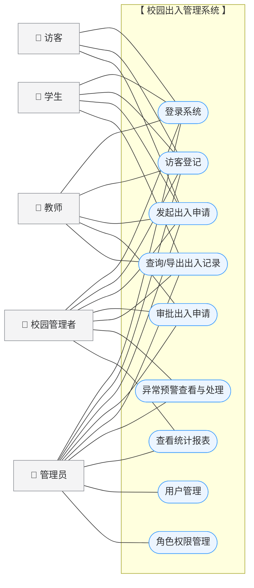

# 校园出入管理系统 — 功能需求分析与用例图

## 1. 系统概述

### 1.1 系统简介

校园出入管理系统面向学校门禁与访客管理场景，覆盖访客登记、出入申请审批、通行记录查询、
异常预警、统计报表以及用户与角色权限管理等业务。

- 在线访问：https://carl-tu.github.io/campus-management/
- 技术栈：Vue 3 + TypeScript + Vite + Element Plus + Pinia（当前为前端实现，数据为本地模拟）
- 初始账号：`admin / 123456`

### 1.2 角色定义

| 角色 | 标识 | 说明 |
| --- | --- | --- |
| 管理员 | admin | 系统最高权限，负责用户与角色权限管理 |
| 校园管理者 | manager | 负责出入审批、异常预警处理与统计分析 |
| 教师 | teacher | 可登记访客、发起与审批出入申请、查询记录 |
| 学生 | student | 可登记访客、发起出入申请、查询记录 |
| 访客 | visitor | 仅可登记访客信息、发起出入申请 |

## 2. 功能需求分析

### F1 用户认证

| 编号 | 功能 | 需求描述 |
| --- | --- | --- |
| F1.1 | 登录 | 输入用户名与密码（必填校验），支持回车快捷登录；成功进入系统，失败给出提示 |
| F1.2 | 登出 | 通过顶部用户下拉菜单退出登录，清除会话与已打开的标签页 |
| F1.3 | 访问控制 | 未登录用户访问受保护页面时自动跳转登录页；已登录用户访问登录页时跳转首页 |

### F2 访客登记

| 编号 | 功能 | 需求描述 |
| --- | --- | --- |
| F2.1 | 访客信息登记 | 登记姓名、手机号（格式校验）、访客类型（访客/教师/学生/校园管理者）、身份证号（选填）、来访事由、校内对接人、预计到访时间 |
| F2.2 | 今日访客列表 | 以列表形式展示当日登记记录，含人员类型彩色标签 |
| F2.3 | 删除登记记录 | 删除需二次确认，防止误操作 |

### F3 出入申请与审批

| 编号 | 功能 | 需求描述 |
| --- | --- | --- |
| F3.1 | 发起申请 | 填写申请人、人员类型、手机号、事由、目标区域、预计时间，提交后状态为「待审批」 |
| F3.2 | 申请搜索 | 支持按申请人姓名、状态（待审批/已通过/已拒绝）筛选，可重置 |
| F3.3 | 审批 | 对待审批申请执行「通过」或「拒绝」，自动记录审核人与审核时间 |
| F3.4 | 查看详情 | 查看申请完整信息（含审核人、审核时间、备注） |
| F3.5 | 分页浏览 | 支持调整页大小（10/20/50）与跳页 |

### F4 出入记录查询

| 编号 | 功能 | 需求描述 |
| --- | --- | --- |
| F4.1 | 组合条件查询 | 支持按姓名、方向（进入/离开）、闸口（东/西/南/北门）、日期范围筛选 |
| F4.2 | 记录列表 | 展示人员类型、方向、闸口、时间、验证方式（人脸识别/刷卡/二维码） |
| F4.3 | 导出记录 | 导出查询结果（当前为占位实现） |
| F4.4 | 分页浏览 | 支持页大小 10/20/50/100 与跳页 |

### F5 用户管理（仅管理员）

| 编号 | 功能 | 需求描述 |
| --- | --- | --- |
| F5.1 | 用户查询 | 按用户名、角色、状态（正常/禁用）筛选 |
| F5.2 | 新增/编辑用户 | 维护用户名、真实姓名、手机号、角色、部门等信息 |
| F5.3 | 禁用/启用 | 切换用户可用状态 |
| F5.4 | 删除用户 | 删除需二次确认 |
| F5.5 | 分页浏览 | 支持页大小 10/20/50 与跳页 |

### F6 角色权限管理（仅管理员）

| 编号 | 功能 | 需求描述 |
| --- | --- | --- |
| F6.1 | 角色列表 | 展示角色标识、名称及已分配权限点 |
| F6.2 | 新增/编辑角色 | 维护角色标识与名称 |
| F6.3 | 分配权限 | 在 7 项权限点（用户管理、角色管理、出入申请审批、访客登记、记录查询、异常预警、统计报表）中勾选分配 |
| F6.4 | 删除角色 | 内置 admin 角色受保护不可删除；删除需二次确认 |

### F7 异常预警

| 编号 | 功能 | 需求描述 |
| --- | --- | --- |
| F7.1 | 预警统计卡片 | 展示未处理预警、超时未离校、未授权进入、全部预警数量 |
| F7.2 | 预警列表 | 覆盖 4 类预警：未授权进入、超时未离校、频繁出入、黑名单命中 |
| F7.3 | 标记已读 | 单条标记已读，或一键全部已读 |
| F7.4 | 处理预警 | 将预警状态置为「已处理」 |

### F8 统计报表

| 编号 | 功能 | 需求描述 |
| --- | --- | --- |
| F8.1 | 统计卡片 | 展示今日进入、今日离开、今日访客、待处理预警数量 |
| F8.2 | 出入趋势图 | 以柱状图展示近 7 日出入趋势 |
| F8.3 | 人员类型分布 | 以占比形式展示学生/教师/访客/校园管理者分布 |
| F8.4 | 闸口通行统计 | 展示各闸口进入/离开人数、高峰时段、通行率 |
| F8.5 | 导出报表 | 导出统计报表（当前为占位实现） |

### F9 通用功能

| 编号 | 功能 | 需求描述 |
| --- | --- | --- |
| F9.1 | 菜单导航 | 左侧菜单栏支持折叠/展开 |
| F9.2 | 多标签页 | 访问页面自动添加标签，支持切换、关闭、关闭其他、关闭所有 |
| F9.3 | 页面缓存 | 已访问页面通过 keep-alive 缓存，返回时保留状态 |

## 3. 角色-功能权限矩阵

| 功能 \ 角色 | 管理员 | 校园管理者 | 教师 | 学生 | 访客 |
| --- | --- | --- | --- | --- | --- |
| 登录系统 / 访客登记 | ✔ | ✔ | ✔ | ✔ | ✔ |
| 发起出入申请 | ✔ | ✔ | ✔ | ✔ | ✔ |
| 审批出入申请 | ✔ | ✔ | ✔ | — | — |
| 查询/导出出入记录 | ✔ | ✔ | ✔ | ✔ | — |
| 异常预警查看与处理 | ✔ | ✔ | — | — | — |
| 统计报表查看 | ✔ | ✔ | — | — | — |
| 用户管理 | ✔ | — | — | — | — |
| 角色权限管理 | ✔ | — | — | — | — |

> 所有业务用例均以「登录系统」为前置条件（身份认证）。

## 4. 用例图

### 4.1 用例与参与者对照

| 用例 | 管理员 | 校园管理者 | 教师 | 学生 | 访客 |
| --- | --- | --- | --- | --- | --- |
| UC1 登录系统 | ✔ | ✔ | ✔ | ✔ | ✔ |
| UC2 访客登记 | ✔ | ✔ | ✔ | ✔ | ✔ |
| UC3 发起出入申请 | ✔ | ✔ | ✔ | ✔ | ✔ |
| UC4 审批出入申请 | ✔ | ✔ | ✔ | — | — |
| UC5 查询/导出出入记录 | ✔ | ✔ | ✔ | ✔ | — |
| UC6 用户管理 | ✔ | — | — | — | — |
| UC7 角色权限管理 | ✔ | — | — | — | — |
| UC8 异常预警查看与处理 | ✔ | ✔ | — | — | — |
| UC9 查看统计报表 | ✔ | ✔ | — | — | — |

## 5. 关键用例描述

### UC3 发起出入申请

| 项 | 内容 |
| --- | --- |
| 参与者 | 全部角色 |
| 前置条件 | 参与者已登录系统 |
| 基本流 | 1. 进入「出入申请与审批」页面 → 2. 点击「发起申请」→ 3. 填写申请表单并通过校验 → 4. 提交，生成「待审批」申请 |
| 异常流 | 3a. 必填项缺失或格式错误：提示并阻止提交 |
| 后置条件 | 新增一条待审批申请记录 |

### UC4 审批出入申请

| 项 | 内容 |
| --- | --- |
| 参与者 | 管理员、校园管理者、教师 |
| 前置条件 | 已登录；存在「待审批」状态的申请 |
| 基本流 | 1. 进入申请列表 → 2. 对待审批记录点击「通过」或「拒绝」→ 3. 状态流转为「已通过」/「已拒绝」，记录审核人与审核时间 |
| 异常流 | 3a. 记录已被审批：按钮不展示，无法重复审批 |
| 后置条件 | 申请状态更新，审核信息入库 |

### UC8 异常预警查看与处理

| 项 | 内容 |
| --- | --- |
| 参与者 | 管理员、校园管理者 |
| 前置条件 | 已登录；存在异常预警记录 |
| 基本流 | 1. 进入「异常预警」页面 → 2. 查看统计卡片与预警列表 → 3. 对预警执行「标记已读」或「处理」 |
| 后置条件 | 预警状态更新为「已读」或「已处理」 |

## 6. 备注：当前实现与完整需求的差距

1. 权限矩阵仅在「角色权限管理」中静态展示，尚未与菜单、按钮、路由做联动控制。
2. 登录当前仅支持 `admin` 单一模拟账号，其余角色无法实际登录验证。
3. 出入记录「导出」、报表「导出报表」为占位实现；趋势图「近 7 天/近 30 天」切换未联动数据。
4. 各模块搜索与分页为 UI 占位（仅重置页码），数据为前端 mock，无后端接口持久化。
5. 申请审批的「拒绝备注」字段暂无录入入口。
