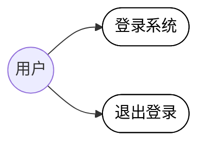
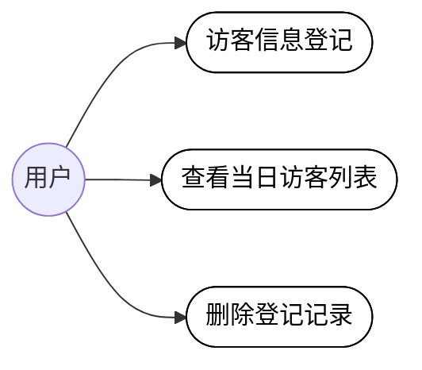
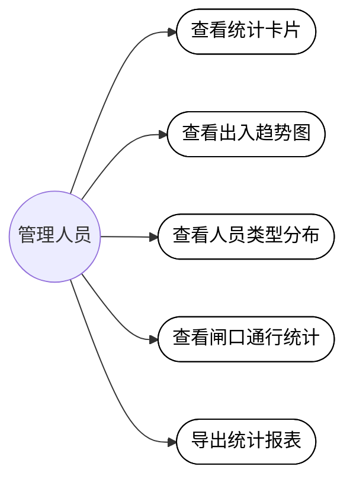

# 校园出入管理系统需求分析

校园出入管理系统面向学校门禁与访客管理场景，供校园内各类用户通过浏览器访问使用，
当前已部署于 GitHub Pages（https://carl-tu.github.io/campus-management/ ，初始账号 admin / 123456）。
系统用户涵盖管理员、校园管理者、教师、学生与访客五种角色，不同角色可使用的功能范围不同。

## 3.2.1 校园出入管理功能需求分析

校园出入管理功能应满足校园门禁与访客管理的业务需求，其核心流程包括用户登录、访客登记、
出入申请与审批、出入记录查询、异常预警、统计报表、用户与角色权限管理七个环节。

### 1. 用户登录模块需求分析

用户登录模块是使用系统的首要入口，应满足各类用户的接入需求与系统安全性要求。
用户通过浏览器访问系统，输入账号与密码进行身份认证，系统应对必填项进行校验并在
认证失败时给出友好提示，同时支持回车快捷登录，操作应方便易用。未登录用户访问受
保护功能时应自动跳转至登录页，已登录用户访问登录页时应自动跳转至首页，确保系统
的访问安全。登录成功后系统应根据用户角色展示相应的功能范围，实现按角色的权限管控，
并保持登录状态直至用户主动退出。用户登录功能对应的用例图如图 3-1 所示。

**图 3-1 用户登录模块用例图**

### 2. 访客登记模块需求分析

访客登记模块是校园出入管理的基础环节，应满足来访人员信息登记与查询的需求。
登记信息应包括访客姓名、手机号（需进行格式校验）、访客类型（访客/教师/学生/校园管理者）、
身份证号、来访事由、校内对接人及预计到访时间等关键内容，其中手机号等关键字段为必填项。
登记提交后系统应实时在当日访客列表中展示登记结果，并以彩色标签区分访客类型，方便
门卫与管理人员核对。对于登记有误的记录，应支持删除操作，删除时需二次确认以防止误操作。
访客登记功能对应的用例图如图 3-2 所示。

**图 3-2 访客登记模块用例图**

### 3. 出入申请与审批模块需求分析

出入申请与审批模块是校园出入管理的核心业务环节，应同时满足申请人与审批人双方的需求。
申请人可填写申请人、人员类型、手机号、事由、目标区域、预计时间等信息发起出入申请，
提交后申请进入待审批状态。审批人对待审批申请可执行通过或拒绝操作，系统应自动记录
审核人与审核时间，并将申请状态流转为已通过或已拒绝。该模块还应支持按申请人姓名与
申请状态的条件筛选查询，并提供申请详情查看与分页浏览功能，方便对大量申请的高效管理。
出入申请与审批功能对应的用例图如图 3-3 所示。

**图 3-3 出入申请与审批模块用例图**

### 4. 出入记录查询模块需求分析

出入记录查询模块是校园安全追溯的重要支撑，应满足管理人员对通行数据的检索与分析需求。
系统应支持按姓名、出入方向（进入/离开）、闸口（东门/西门/南门/北门）及日期范围进行
组合查询，列表应展示人员类型、方向、闸口、通行时间及验证方式（人脸识别/刷卡/二维码）
等关键信息，并以不同标签区分进入与离开方向。该模块还需支持查询结果的导出与分页浏览，
满足数据留档与上报的要求。出入记录查询功能对应的用例图如图 3-4 所示。

**图 3-4 出入记录查询模块用例图**

### 5. 异常预警模块需求分析

异常预警模块是校园安全防控的关键功能，应满足管理人员及时发现与处置异常情况的需求。
系统应对未授权进入、超时未离校、频繁出入、黑名单命中等异常情况生成预警记录，并以
统计卡片形式实时展示未处理预警、超时未离校、未授权进入及全部预警的数量。管理人员
可对预警进行单条标记已读、一键全部已读及处理操作，处理后的预警状态置为已处理，
形成"发现—处置—闭环"的安全管理流程。异常预警功能对应的用例图如图 3-5 所示。

**图 3-5 异常预警模块用例图**

### 6. 统计报表模块需求分析

统计报表模块是辅助管理决策的重要工具，应满足管理者对通行数据可视化分析的需求。
系统应提供今日进入、今日离开、今日访客、待处理预警等关键指标卡片，以柱状图展示
近七日出入趋势，以占比形式展示学生、教师、访客、校园管理者等人员类型分布，并统计
各闸口的进入与离开人数、高峰时段及通行率，最后支持报表数据的导出，为校园安保
资源调配提供数据依据。统计报表功能对应的用例图如图 3-6 所示。

**图 3-6 统计报表模块用例图**

### 7. 用户与角色权限管理模块需求分析

用户与角色权限管理模块是系统安全运行的基础保障，应满足管理员对系统用户与权限统一
管控的需求。用户管理方面，管理员可按用户名、角色、状态检索用户，完成用户的新增、
编辑、禁用/启用与删除等维护操作，被管理对象覆盖全部五种角色。角色权限管理方面，
系统预置管理员、校园管理者、教师、学生、访客五种角色，管理员可新增或编辑角色，
并在用户管理、角色管理、出入申请审批、访客登记、记录查询、异常预警、统计报表等
权限点中为角色分配权限；内置的管理员角色受保护不可删除，防止权限失控。
用户与角色权限管理功能对应的用例图如图 3-7 所示。

**图 3-7 用户与角色权限管理模块用例图**

不同角色可使用的功能范围不同：管理员拥有全部功能；校园管理者可进行访客登记、
出入申请与审批、出入记录查询、异常预警及统计报表；教师可进行访客登记、出入申请
与审批、出入记录查询；学生可进行访客登记、出入申请及出入记录查询；访客仅可进行
访客登记与出入申请。校园出入管理功能的总用例图如图 3-8 所示。

**图 3-8 校园出入管理功能总用例图**

## 3.3 非功能需求分析

本系统非功能需求分析主要包括以下内容：

### 3.3.1 性能需求分析

系统各功能页面的加载时间要快，一般需控制在 2 秒以内；出入申请提交、审批操作及
访客登记后，系统的反馈时间需小于 1 秒；上下课等高峰时段需支持多用户同时访问，
并发用户数可设置为大于 500；出入记录、申请列表等数据应采用分页加载，避免一次性
加载大量数据造成页面卡顿，保障系统的响应速度与流畅体验。

### 3.3.2 可靠性需求分析

系统可靠性、可用性需达到 99.9% 及以上，系统故障恢复的时间要小于等于 20 分钟，
特别要避免由于宕机导致登记信息、申请数据丢失或服务中断的情况。前端应做好异常
捕获与友好提示，保证在网络异常或操作失败时不产生脏数据；对删除用户、删除登记
记录等危险操作提供二次确认机制，防止数据被误删，确保系统持续稳定运行。

### 3.3.3 安全性需求分析

系统需要通过多种措施来确保系统的安全性，可以从系统的机密性、权限身份认证、
数据完整性等措施来实现。机密性方面，可以确保用户密码等敏感信息在传输与存储过程
中不被泄露，如通过 HTTPS 加密传输、敏感字段脱敏展示。权限身份认证方面，用户需
登录后方可使用系统，通过路由守卫对未登录访问进行拦截，并按管理员、校园管理者、
教师、学生、访客五种角色限制功能使用范围，在访问控制与身份认证等环节确保系统安全。
数据完整性方面，对手机号等关键字段进行格式校验，防止非法数据录入，并对审批、
预警处置等关键操作记录审核人与操作时间，做到行为可追溯。

### 3.3.4 可扩展性需求分析

系统应采用模块化设计，访客登记、出入申请与审批、出入记录查询、异常预警、统计
报表、用户与角色权限管理等各功能模块之间低耦合，便于后续扩展黑名单管理、人脸识别
对接、多校区支持等新业务功能；权限点支持灵活配置，新增角色或权限项时无需调整系统
整体架构；页面组件、类型定义与状态管理模块可复用，便于快速扩展新的页面与功能，
保护已有投资。

### 3.3.5 可维护性需求分析

前端应采用目前常用的核心技术（Vue 3 + TypeScript + Vite + Element Plus），构成
系统网页结构、样式和交互；代码采用组件化组织与 Pinia 状态管理，路由与权限配置
集中管理，降低代码阅读与修改难度；支持独立更新出入申请管理、记录查询、统计报表等
功能模块，配合持续集成自动构建部署，最大程度降低维护成本。

### 3.3.6 兼容性需求分析

系统应需多端适配，能支持主流浏览器（如 Chrome、Edge、Safari、Firefox 及各类国产
浏览器），系统界面应能自动适配手机、平板、电脑等电子设备的分辨率；采用响应式布局，
侧边栏与内容区在不同屏幕尺寸下均能正常展示，确保用户在不同终端上获得一致的使用体验。

### 3.3.7 易用性需求分析

系统界面应简洁直观，操作逻辑符合用户使用习惯，降低学习成本；采用左侧菜单导航与
多标签页设计，方便用户在各功能模块间快速切换与返回；表单提供清晰的必填标识、格式
校验与操作反馈提示（如登录成功/失败、登记成功、审批完成提示），删除等危险操作提供
二次确认；人员类型、预警状态、通行方向等关键信息以彩色标签、统计卡片等可视化形式
呈现，便于用户快速理解与使用。

---

**备注：** 当前系统为前端实现（数据为本地模拟），权限矩阵尚未与菜单、按钮、路由
联动控制；出入记录导出、报表导出及趋势图时间切换为占位实现，待后续与后端接口对接完善。
